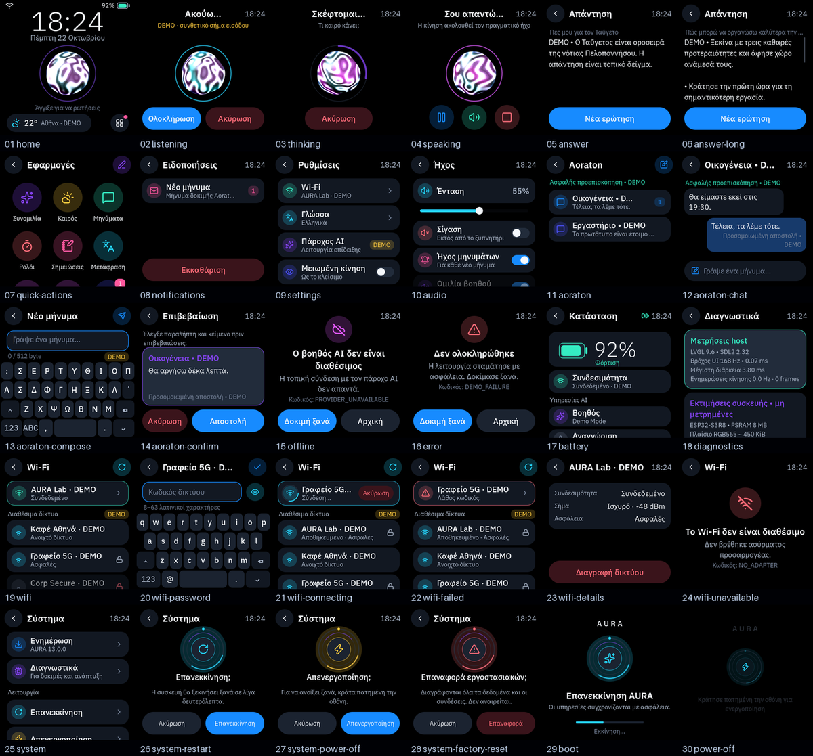
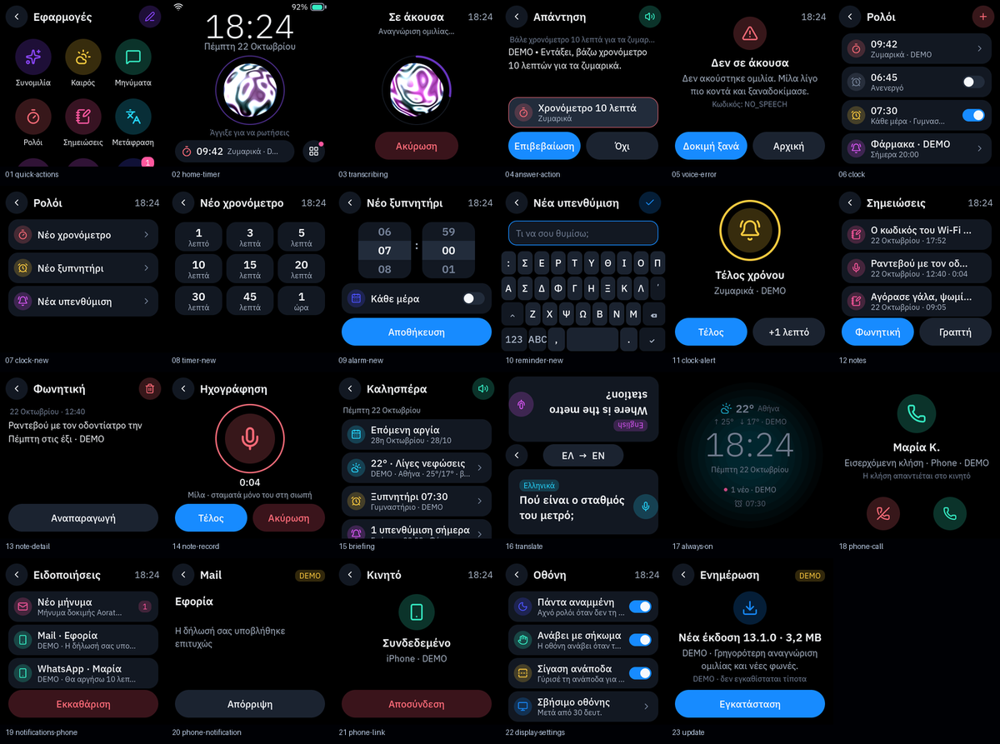
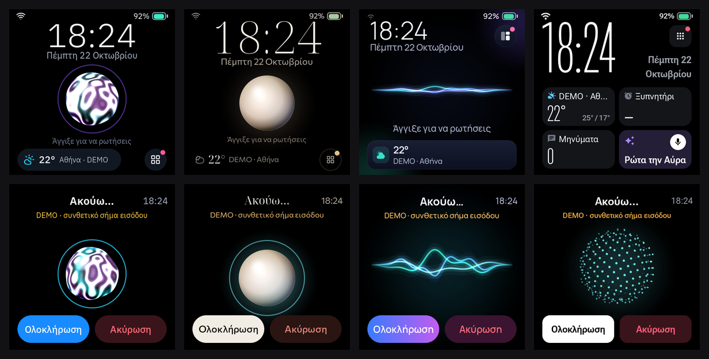

# AURA

**A Greek-first AI companion for a 480 × 480 AMOLED ESP32-S3 device.** One shared C++17 core and LVGL interface run in two places: a native Windows simulator you can use today, and ESP-IDF firmware for the Waveshare ESP32-S3-Touch-AMOLED-2.16 board.

> **Status (October 2026).** The simulator is feature-complete for the v13 "Companion" release and passes the full automated suite. The firmware compiles cleanly with ESP-IDF 5.5.5 but **has not been flashed**: nothing that depends on the physical board is claimed to work yet. See [docs/VERIFICATION.md](docs/VERIFICATION.md) for every result.





All names, rooms, messages and data in the screenshots are fictional `DEMO` content.

## Σύντομα στα ελληνικά

Η AURA είναι ένας ελληνόφωνος βοηθός AI για μια μικρή συσκευή με τετράγωνη οθόνη AMOLED 480 × 480 (ESP32-S3). Μιλάς ή γράφεις και απαντά με φωνή και κείμενο. Έχει ρολόι, ξυπνητήρια, υπενθυμίσεις, σημειώσεις (και φωνητικές), ημερολόγιο με εργασίες και λίστα αγορών, καιρό, ελληνικό ραδιόφωνο, εορτολόγιο και αργίες, τιμές καυσίμων, μετάφραση πρόσωπο με πρόσωπο, μηνύματα Aoraton με κρυπτογράφηση και ειδοποιήσεις από το iPhone. Έχει τέσσερις εμφανίσεις (Άλως, Μάρμαρο, Σέλας, Γραφίτης) που επιλέγεις από τις Ρυθμίσεις → Εμφάνιση. Ο ίδιος κώδικας τρέχει στον προσομοιωτή των Windows και στο firmware της συσκευής. Ο προσομοιωτής δουλεύει σήμερα· το firmware χτίζεται, αλλά δεν έχει δοκιμαστεί ακόμα σε πραγματική πλακέτα.

## Contents

- [What AURA does](#what-aura-does)
- [How it is built](#how-it-is-built)
- [Getting started on Windows](#getting-started-on-windows)
- [Testing](#testing)
- [Firmware](#firmware)
- [Security and privacy](#security-and-privacy)
- [Known limitations](#known-limitations)
- [Documentation](#documentation)
- [Working on the code](#working-on-the-code)
- [License](#license)

## What AURA does

### Assistant

- **Voice and text.** Tap the orb or type. Answers stream in as they are written, and on a voice turn the first sentence is spoken while the rest is still arriving.
- **Natural conversation.**
  - A follow-up question ("and tomorrow?") keeps the context of the last few turns for five minutes; the history is never written to disk.
  - Continuous conversation listens again after an answer.
  - Speaking over an answer interrupts it (barge-in).
- **Greek and English.** The interface, speech recognition and voices follow the chosen language.
- **Actions with confirmation.** The assistant can propose a timer, alarm, reminder, note, task, shopping item, calendar event or message. Nothing happens until you confirm it on the screen.
- **Works offline for everyday commands.** Timers, alarms, notes, tasks, shopping, volume, mute, brightness, the time, the battery and opening apps are understood on the device itself, in Greek and English. A sentence that merely mentions these words is left to the assistant.
- **Local answers.** "Who celebrates today?", "When does Γιώργος celebrate?" and "When is the next public holiday?" are answered from an offline Greek Orthodox calendar.
- **Explicit web search.** "Ψάξε…" / "search for…" uses live search only when the provider has a real search tool (the Codex CLI); otherwise the assistant says it cannot search right now.

### Apps

The apps grid can be rearranged: tap the pencil, then an app, then its new place.

| App | What it offers |
|---|---|
| Conversation | The assistant, with recent history, follow-up and new-topic actions |
| Weather | Open-Meteo forecast for any city, hourly and daily views, animated conditions, offline cache |
| Messages | Aoraton end-to-end-encrypted rooms: sign-in through the PC browser, read and send with confirmation, optional `@inco` AI answers |
| Clock | Timers, alarms (once or daily) and reminders, with a full-screen alert that rings even when muted |
| Notes | Typed and voice notes; a voice note is dictated (up to 30 s, past short pauses) and transcribed |
| Translate | Face-to-face translation with one card turned towards the other person |
| Today | Greeting, namedays, next public holiday, weather, average Greek fuel prices, alarms, reminders, timers and unread messages |
| Radio | Greek stations, a station directory search (worldwide when no Greek station matches), favourites with your own order, now-playing titles, automatic reconnection; "βάλε ραδιόφωνο" plays the last station again |
| Notifications | AURA and phone notifications in one place |
| Organizer | Agenda, tasks and shopping list |
| Settings | Wi-Fi, language, appearance, AI provider, reduced motion, sound, display, voice, weather and system |

### Device

- **Always-on clock and power saving.** The screen dims, then shows an always-on clock. Dimming is always relative to your chosen brightness.
- **Gestures.** Raise to wake, and flip face down to mute.
- **Sound settings.** Volume, mute, message chime, spoken answers and continuous conversation.
- **System.** Updates (OTA with rollback), diagnostics, restart, power off, and a factory reset that erases everything.
- **Phone link.** Notifications and calls from a paired iPhone over Bluetooth LE (ANCS). In the simulator this uses the PC's Bluetooth adapter and is experimental.

### Appearances

Settings → Εμφάνιση offers four looks. A look sets the colours, typefaces, icons and components everywhere, gives six screens their own layout (Home, the answer, Apps, Weather, a running timer and Today) and brings its own animated presence for listening, thinking and speaking. The choice is stored on the device and applied before the first frame.

| Look | Character | Type | Icons | Presence |
|---|---|---|---|---|
| Άλως (Halo) | The original look | IBM Plex Sans | Lucide | Mercury, a liquid-metal orb |
| Μάρμαρο (Marble) | Quiet luxury: ivory and champagne on black, hairlines | Noto Serif Display, Commissioner | Phosphor Light | Μαργαριτάρι, a pearl |
| Σέλας (Aurora) | Living light: glass surfaces and soft light fields | Manrope | Solar Bold Duotone | Σέλας, three ribbons of light |
| Γραφίτης (Graphite) | A precision instrument: live tiles and gauges | Roboto Flex | Material Symbols Rounded | Αστερισμός, a sphere of points |



`python scripts/compose-appearances.py` makes this picture from simulator captures; run it after changing a look's Home or presence.

## How it is built

```text
                ┌──────────────────────────────────────────────┐
                │ shared/core  models, rules, parsers (no UI)  │
                │ shared/ui    LVGL 9.6 interface              │
                │ shared/localization  Greek / English strings │
                └──────────────────┬───────────────────────────┘
                 same code         │          same code
        ┌──────────────────────────┴───────┐   ┌───────────────────────────────┐
        │ simulator/  Windows, SDL2 2.32   │   │ firmware/  ESP-IDF 5.5.5       │
        │ WinHTTP, audio, radio, Wi-Fi,    │   │ Waveshare BSP, ES8311 audio,   │
        │ iPhone ANCS, local stores        │   │ NimBLE ANCS, OTA, microSD      │
        └──────────────┬───────────────────┘   └───────────────────────────────┘
                       │ loopback only (127.0.0.1, bearer token)
        ┌──────────────┴───────────────────┐
        │ bridge/  Node.js ≥ 20            │──► Codex CLI · Groq · Azure Speech
        │ assistant turns, speech, fuel    │
        └──────────────────────────────────┘
```

The device itself never holds an AI provider key. Production AI will go through an authenticated gateway ([ADR 0003](docs/ADR/0003-streaming-ai-gateway-and-device-secrets.md)); the bridge is desktop development tooling.

| Path | Contents |
|---|---|
| `shared/core` | Assistant state machine, streaming, offline commands, organizer, clock, notes, radio, weather, Greek calendar, fuel, Aoraton, voice front end and echo cancellation, display power |
| `shared/ui` | Every screen, the keyboard, motion and the design tokens |
| `shared/localization` | All Greek and English text |
| `shared/assets` | Fonts (IBM Plex, Space Grotesk, Noto Serif Display, Commissioner, Manrope, Roboto Flex), icons (Lucide, Phosphor, Solar, Material Symbols) and images, with their licenses |
| `simulator/app` | The Windows simulator and its platform services |
| `simulator/controls` | A loopback control page for simulated events |
| `bridge` | The loopback bridge: Codex CLI and Groq runners, speech (Groq Whisper, Azure, Windows voices), fuel prices |
| `firmware` | The ESP-IDF project and its components |
| `tests` | Unit, integration, interoperability and smoke tests |
| `scripts` | Setup, build, test and evidence scripts |
| `docs` | Architecture, decisions (ADRs), design, security and the verification ledger |

## Getting started on Windows

### Requirements

- Windows 10 or 11 with PowerShell 5.1.
- Git and Node.js 20 or newer.
- Python 3 with Pillow (`python -m pip install --user pillow==12.2.0`), for the evidence checks in the test suite.
- Several gigabytes of free space. The portable toolchain and optional speech models take about 4 GB on the development PC.

The setup installs pinned portable tools under the ignored `.tools` folder: CMake, Ninja and the w64devkit compiler. It does not change the system `PATH`.

### First run

```powershell
git clone https://github.com/konskall/aura.git
cd aura
.\scripts\setup-windows.ps1
.\run.bat mock        # DEMO answers, no account needed
```

`run.bat` builds whatever changed and opens the 480 × 480 simulator together with its control page. Without an argument it uses the locally signed-in Codex CLI.

### Choosing the assistant and voices

```powershell
.\scripts\dev-simulator.ps1 -Provider mock|codex|groq `
                            -SpeechProvider local|groq `
                            -TtsProvider auto|windows|azure|neural
```

- **`-Provider`**
  - `mock`: labelled DEMO answers.
  - `codex`: the Codex CLI you are signed in to (`codex login status`).
  - `groq`: streamed Groq chat.
- **`-SpeechProvider`**
  - `local`: whisper.cpp on this PC; install it with `.\scripts\setup-voice.ps1`.
  - `groq`: Groq Whisper (`whisper-large-v3-turbo`).
- **`-TtsProvider`**
  - `auto`: official Azure Speech when configured, otherwise the installed Windows voices.
  - `neural`: an unofficial Edge read-aloud service. It is never chosen automatically and the launcher warns when you select it.
- **`-EnableIphoneAncs`**: shows the notifications of a paired iPhone ([docs/phone/IPHONE_WINDOWS_ANCS.md](docs/phone/IPHONE_WINDOWS_ANCS.md)).

Keys for Groq and Azure go in a local `.env` file next to `.env.example`. The file is ignored by git and is never copied into firmware.

```text
GROQ_API_KEY=<your Groq key>
AZURE_SPEECH_KEY=<your Azure Speech key>
AZURE_SPEECH_REGION=<your Azure region, for example swedencentral>
```

### Optional extras

- **Aoraton account.** Run `.\scripts\setup-aoraton.ps1` once; sign-in happens in the PC browser ([docs/SIMULATOR.md](docs/SIMULATOR.md)).
- **Fuel prices.** These come from the European Commission Weekly Oil Bulletin. The launcher renews the local cache in the background when it is more than a week old; to refresh it by hand, run `.\scripts\update-eu-fuel-prices.ps1`.
- **Azure voices.** `.\scripts\start-azure-speech-simulator.ps1` starts the simulator with the Azure Athina and Nestoras voices. It uses Codex answers and local speech recognition unless you choose otherwise with `-Provider` and `-SpeechProvider`.

## Testing

```powershell
.\scripts\test.ps1
```

The authoritative suite runs everything that can be checked on a PC. It contacts no production service.

- **Setup and build.**
  - Local environment checks.
  - A native Release build.
  - An ESP-IDF-compatible compile of every shared source (`-Wall -Wextra -Werror`, no exceptions or RTTI).
- **Tests.**
  - 29 CTest suites, including loopback tests for streaming and for Shoutcast radio.
  - Bridge and control-page tests (`node --test`).
  - A smoke run and a 380-transition UI stress run.
- **Evidence.**
  - Real SDL/LVGL pointer checks of every route at 1× and 2× scale (200 checks each).
  - Screenshot and motion evidence of every screen, written to the ignored `artifacts/` folder.

Single test programs can be built and run from `build/native`, for example `ninja -C build/native aura_radio_tests`. Bridge tests run with `node --test` inside `bridge/`.

## Firmware

**Target board.** Waveshare ESP32-S3-Touch-AMOLED-2.16:

- ESP32-S3R8 with 8 MiB PSRAM and 16 MiB flash;
- 480 × 480 AMOLED (CO5300);
- CST9220 touch;
- AXP2101 power management;
- QMI8658 IMU and PCF85063 RTC;
- ES7210 microphones and ES8311 codec;
- microSD.

See [docs/HARDWARE.md](docs/HARDWARE.md).

```powershell
. C:\path\to\esp-idf-v5.5.5\export.ps1     # activate ESP-IDF 5.5.5
.\scripts\build-firmware.ps1                 # development image
.\scripts\build-firmware-production.ps1      # Secure Boot V2 + flash encryption profile
```

**What the firmware has today.** The shared UI and models, weather, sound, display power, the organizer, clock and notes, OTA with rollback, and iPhone ANCS through NimBLE.

**What is not available on the device yet.**

- **Needs an external service.** The assistant, speech, radio playback and real Aoraton messaging need the production gateway or other backends; until then they stay disabled or clearly labelled.
- **Needs the board.** Everything physical still has to be validated: display, touch, audio, battery and Wi-Fi/TLS behaviour.

The production signing keys are never stored in the repository.

## Security and privacy

- **Secrets stay on the PC.** Provider keys exist only in the PC's process environment or the ignored `.env`. They are never logged or committed, and never put in firmware.
- **The bridge is local.** It listens only on `127.0.0.1` and requires a fresh bearer token for each run.
- **Untrusted text is data.** Device facts, conversation history and web pages go to the model as data, never as instructions. Model output cannot act without typed validation and your confirmation.
- **Messages and audio stay private.** Message text, transcripts and audio are not written to logs. Aoraton messages are end-to-end encrypted.
- **Demo data is labelled.** Fictional or simulated data is always marked `DEMO`.

Details: [docs/SECURITY_PRIVACY.md](docs/SECURITY_PRIVACY.md) and the [Aoraton security boundaries](docs/aoraton/SECURITY_BOUNDARIES.md).

## Known limitations

- **The firmware has not run on hardware.** Heap and stack peaks, frame rate, power use and touch accuracy are unmeasured.
- **There is no wake word.** No trained and measured Greek "Αύρα" model exists yet, so listening starts with a tap.
- **Echo cancellation is untuned.** It works in tests, but still needs tuning in a real room and on the device's microphones.
- **iPhone disconnect handling is untested live.** Detecting that the phone has gone, and reconnecting, needs a session with a paired iPhone.
- **Radio has two limits.** Only MP3 stations are supported, and radio on the device waits for a playback backend.

## Documentation

| Topic | Where |
|---|---|
| Architecture | [docs/ARCHITECTURE.md](docs/ARCHITECTURE.md), [docs/architecture/SYSTEM_OVERVIEW.md](docs/architecture/SYSTEM_OVERVIEW.md) |
| Simulator guide | [docs/SIMULATOR.md](docs/SIMULATOR.md), [docs/simulator/WINDOWS_SETUP.md](docs/simulator/WINDOWS_SETUP.md) |
| Decisions | [docs/ADR](docs/ADR) |
| Verification ledger | [docs/VERIFICATION.md](docs/VERIFICATION.md) |
| Weather | [docs/WEATHER_ARCHITECTURE.md](docs/WEATHER_ARCHITECTURE.md) |
| Audio | [docs/audio/AUDIO_ARCHITECTURE.md](docs/audio/AUDIO_ARCHITECTURE.md) |
| Aoraton messaging | [docs/aoraton/LIVE_ARCHITECTURE.md](docs/aoraton/LIVE_ARCHITECTURE.md) |
| v13 Companion design | [docs/design/AURA_V13_COMPANION_DESIGN.md](docs/design/AURA_V13_COMPANION_DESIGN.md) |
| Screens and routes | [docs/ui/FEATURE_AND_ROUTE_PARITY.md](docs/ui/FEATURE_AND_ROUTE_PARITY.md) |
| Roadmap | [docs/ROADMAP.md](docs/ROADMAP.md) |

## Working on the code

[AGENTS.md](AGENTS.md) holds the repository rules that people and coding agents both follow. Two of them shape every change:

- Every meaningful build or test result is recorded in [docs/VERIFICATION.md](docs/VERIFICATION.md) as `PASSED`, `FAILED`, `NOT RUN` or `NEEDS HARDWARE`. A check that did not run is never claimed.
- Shared code must also compile for the ESP32. That means C++17 with `gnu++2b` compatibility, no exceptions or RTTI, and no warnings.

Text files use LF line endings; PowerShell and batch scripts use CRLF ([.gitattributes](.gitattributes)).

## License

No license file has been added yet. Until one is, the AURA source code is not licensed for reuse.

Third-party components keep their own licenses:

- fonts, icons and images: [shared/assets/THIRD_PARTY.md](shared/assets/THIRD_PARTY.md);
- the Σέλας icons are the Solar icon set by 480 Design, under [CC BY 4.0](shared/assets/licenses/SOLAR_CC_BY_4.0.txt);
- the minimp3 decoder: [shared/third_party/minimp3/LICENSE](shared/third_party/minimp3/LICENSE).
